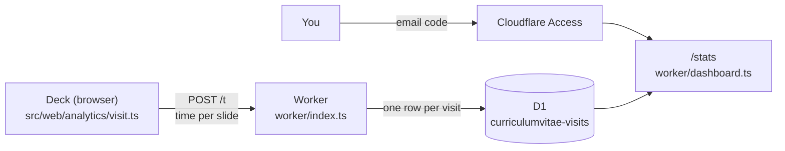

# Visit statistics

The site counts its own visits: when someone looked, roughly from where, and
how long each slide was on screen. The numbers are on a private page,
<https://steinmaerivoet.dev/stats>, that only the owner can open.



## What Cloudflare gives without this

- **Web Analytics** (free, *Analytics & Logs → Web Analytics*): page views,
  visits, country, referrer, browser and Core Web Vitals. It sees the CV as one
  page, so it knows nothing about slides, and it shows totals, not visits.
- **Workers metrics** (the Worker's *Metrics* tab): requests and errors only.

Both can stay on next to this. This adds what they lack: one row per visit,
with the time spent on every slide.

## What is stored

One row per visit, updated while the visit goes on:

| Field | Where it comes from |
| --- | --- |
| When | First and last beacon of the visit |
| Country, region, city | Cloudflare's lookup of the IP address. The address itself is never stored. |
| Network | The organisation behind the IP range (`asOrganization`): a company when someone browses from an office network, otherwise their internet provider |
| Source | The `?ref=` (or `utm_source`) tag of the link, otherwise the host of the referring site (`linkedin.com`), otherwise "direct" |
| Device, browser, OS | A coarse reading of the User-Agent (`worker/device.ts`) |
| Theme, language, window size | Reported by the page |
| Time per slide, and the order of slides | Reported by the page |

Time counts only while the tab is visible and someone used it in the last two
minutes, so a tab left open does not inflate it.

## Privacy

The tracker is built so that it needs no consent banner under GDPR and the
ePrivacy rules:

- No cookies and no browser storage. The visit id is random and lives only in
  the page's memory: a second visit cannot be linked to the first.
- No IP addresses, no fingerprinting, no full referrer URLs (only the host).
- Nothing is sent when the browser asks for it (Do Not Track or Global Privacy
  Control), for bots and automated browsers, and on previews and local builds.
- Rows are deleted after 180 days by the Worker's nightly cron trigger
  (`RETENTION_DAYS` in `worker/store.ts`).
- The contact slide says so (`contact.privacy` in `src/content/data.yaml`).

So the site cannot tell *who* someone is. What works is a **tagged link**: give
each recruiter or company its own link, such as
`https://steinmaerivoet.dev/?ref=acme`, and their visits show up under "acme".
Tags may contain letters, digits, `.`, `_`, `-` and `@`.

## Leaving out your own visits

Open `https://steinmaerivoet.dev/?notrack` once in every browser you use. That
browser is then never counted. `?track` undoes it.

## The dashboard

`/stats` shows, for the last 7, 30, 90 or 180 days: the number of visits, how
many stayed at least 10 seconds, the median time on site, visits per day, how
many visits reached each slide and how long they stayed there, the top
sources, networks, countries and devices, and every visit with its time per
slide. `/stats/visits.csv` downloads the same visits as a spreadsheet.

The page is behind **Cloudflare Access**, which asks for a one-time code sent
to the owner's email. The Worker also checks the token Access signs, so the
page stays closed even if the Access application is removed: without
`ACCESS_TEAM_DOMAIN` and `ACCESS_AUD` it answers 503, with a wrong or missing
token 403.

## Setup (once)

### 1. Let the deploy create the database

Wrangler creates the D1 database `curriculumvitae-visits` on the first deploy
and reuses it after that. The API token used by GitHub Actions needs the right
to do so:

1. In Cloudflare, go to **My Profile → API Tokens**, and edit the token that
   is in the GitHub secret `CLOUDFLARE_API_TOKEN`.
2. Add the permission **Account → D1 → Edit** and save. The token value stays
   the same.
3. If preview builds in Workers Builds fail with a D1 permission error, do the
   same for the token Workers Builds created (it is in the same list).

### 2. Put Cloudflare Access in front of /stats

1. Open **Zero Trust** in the Cloudflare dashboard. The first time, pick a team
   name (for example `stein`) and the **Free** plan. Cloudflare may ask for a
   payment method; the Free plan costs nothing for up to 50 users.
2. Go to **Access → Applications → Add an application → Self-hosted**.
3. Name it `CV statistics`, and add two public hostnames: domain
   `steinmaerivoet.dev` with path `stats`, and the same domain with path
   `stats/*`.
4. Add a policy: action **Allow**, include **Emails** → your own address.
   Leave the login method on **One-time PIN**.
5. Save, then copy two values:
   - the **Application Audience (AUD) Tag** from the application's overview,
   - the **team domain**, `https://<team>.cloudflareaccess.com` (Zero Trust →
     **Settings → Custom pages**, or the team name from step 1).
6. Put them in `ACCESS_AUD` and `ACCESS_TEAM_DOMAIN` under `vars` in
   [`wrangler.jsonc`](wrangler.jsonc) and push to `main`.

Open <https://steinmaerivoet.dev/stats>: Access asks for your email, mails a
code, and shows the statistics.

## Looking at the raw data

```sh
npx wrangler d1 execute curriculumvitae-visits --remote \
  --command "SELECT datetime(started_at/1000,'unixepoch') AS at, ref, referrer, city, org, total_ms FROM visits ORDER BY started_at DESC LIMIT 20"
```

## Code

| File | What |
| --- | --- |
| `src/web/analytics/visit.ts` | The tracker in the deck: counts time per slide, sends beacons with `sendBeacon` |
| `worker/index.ts` | Routes `/t` and `/stats`; every other path is served from `dist/` without running the Worker |
| `worker/beacon.ts` | Checks and trims a beacon |
| `worker/device.ts` | Device class, browser and OS from the User-Agent; bot filter |
| `worker/store.ts` | The D1 table (created on first use), upsert, queries, purge |
| `worker/access.ts` | Verifies the Cloudflare Access token |
| `worker/dashboard.ts` | The `/stats` page and the CSV |

The Worker has its own `tsconfig.json` (Cloudflare's types, not the DOM's) and
is checked by `npm run check:worker`, part of `npm run build`. Its unit tests
are in `tests/unit/worker.test.ts`. To try it locally:

```sh
npm run build
npx wrangler dev --var SITE_HOST:localhost
```

The page only sends beacons from the production site, so post one by hand
with `curl -X POST --data '{"v":"<uuid>","t":"plain","s":{"hero":3000}}'
localhost:8787/t`. It lands in a local D1 database (`.wrangler/`). `/stats`
needs the Access variables, so locally it answers 503.
