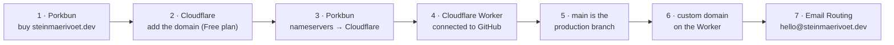

# Domain, hosting and email: how steinmaerivoet.dev was set up

This is every step taken to put the site online, in order, so it can be
repeated or repaired. It is a one-time setup; after it, a push to `main` is
all it takes to publish.



| Piece | Where | Why |
| --- | --- | --- |
| Domain registration | Porkbun | Where `steinmaerivoet.dev` was bought. Only the nameservers are set there. |
| DNS | Cloudflare | Porkbun's nameservers point to Cloudflare, so every DNS record is managed in Cloudflare. |
| Hosting | Cloudflare Worker `curriculumvitae` | Serves the static build in `dist/` ([`wrangler.jsonc`](wrangler.jsonc)). |
| Builds | Cloudflare Workers Builds | Builds and deploys on every push to GitHub. |
| Email | Cloudflare Email Routing | Forwards `hello@steinmaerivoet.dev` to a private mailbox. |

## 1. Buy the domain at Porkbun

`steinmaerivoet.dev` was registered at <https://porkbun.com>. A `.dev` domain
only works over HTTPS (browsers enforce it through HSTS preloading), which
Cloudflare handles from step 6 on.

## 2. Add the domain to Cloudflare

1. Create a free account at <https://dash.cloudflare.com/sign-up>, or log in.
2. Click **Add a domain** (or *Onboard a domain*), enter `steinmaerivoet.dev`
   and choose **Quick scan for DNS records**.
3. Pick the **Free** plan.
4. Cloudflare lists the DNS records it found. Porkbun adds "parking" records
   by default (an `ALIAS`/`A` on `@` and a `CNAME` on `*` or `www` pointing to
   `pixie.porkbun.com`). These have to go eventually (see step 6); deleting
   them now saves a detour.
5. Cloudflare shows **two nameservers**, such as `xxx.ns.cloudflare.com` and
   `yyy.ns.cloudflare.com`. Keep this tab open.

## 3. Point Porkbun's nameservers to Cloudflare

1. At Porkbun, go to **Account → Domain Management**.
2. Next to `steinmaerivoet.dev`, open **Details** and click the pencil next to
   **Authoritative Nameservers**.
3. Replace Porkbun's nameservers with the two from Cloudflare, one per line,
   and save.
4. If **DNSSEC** is on at Porkbun, turn it off first. It can be turned on
   again later from Cloudflare.
5. Back in Cloudflare, click **Check nameservers**. It is usually active
   within an hour (sometimes up to 24 hours), and Cloudflare sends an email
   when the domain is "Active".

From here on, every DNS change happens in Cloudflare, not at Porkbun.

## 4. Create the Worker and connect GitHub

The site is fully static, so the Worker does nothing but serve the files
Astro builds into `dist/`.

1. In Cloudflare: **Workers & Pages → Create → Import a repository**.
2. Connect the GitHub account and give Cloudflare access to
   `steinmaerivoet/CurriculumVitae`.
3. Settings:
   - **Project name**: `curriculumvitae` (it must match `name` in `wrangler.jsonc`)
   - **Build command**: `npm run build`
   - **Deploy command**: `npx wrangler deploy` (the default)
   - **Non-production branch deploy command**: `npx wrangler versions upload` (the default)
   - Node comes from [`.nvmrc`](.nvmrc) (22). If a build ever picks an older
     one, add the build variable `NODE_VERSION` = `22`.
4. **Deploy**.

The repo carries the Worker's configuration in
[`wrangler.jsonc`](wrangler.jsonc):

```jsonc
{
  "name": "curriculumvitae",
  "compatibility_date": "2026-10-01",
  "assets": { "directory": "./dist" },
  "previews": {}
}
```

The empty `previews` block is required. Without it, preview builds of other
branches fail with *"Your Wrangler configuration is missing a `previews`
block"*. Response headers (caching, CORS for the API, security headers) come
from [`public/_headers`](public/_headers), which the Worker's static assets
honour.

## 5. Make `main` the production branch

The first commits lived on a feature branch. To deploy from `main`:

1. On GitHub, in [repository settings → Default branch](https://github.com/steinmaerivoet/CurriculumVitae/settings),
   switch the default branch to `main`.
2. In Cloudflare, open the Worker → **Settings → Build → Branch control** and
   set the production branch to `main`.

Now every push to `main` is built and published. Every other branch and pull
request gets a preview at
`<branch>-curriculumvitae.steinmaerivoet.workers.dev`, and the build status
shows up as a check on the pull request.

`npm run build` also validates `src/content/data.yaml`. If the content is
broken, the build fails with the field that is wrong, and the previous version
stays online.

## 6. Connect the custom domain

1. Open the Worker → **Settings → Domains & Routes → Add → Custom domain**.
2. Enter `steinmaerivoet.dev` and confirm. Because the domain is already in
   Cloudflare, it creates the DNS record and the HTTPS certificate itself,
   usually within minutes.

Adding it the first time failed with:

> Hostname 'steinmaerivoet.dev' already has externally managed DNS records
> (A, CNAME, etc). Delete them first or try a different hostname.

That came from Porkbun's parking records, copied over in step 2. The fix:

1. In Cloudflare, open `steinmaerivoet.dev` → **DNS → Records**.
2. Delete every **A**, **AAAA** and **CNAME** record named
   `steinmaerivoet.dev` or `@` (and those named `www` if `www` should work too).
3. Keep the **MX** and **TXT** records: email forwarding (step 7) needs them.
4. Add the custom domain on the Worker again.

Optional: to send `www.steinmaerivoet.dev` to the bare domain, add `www` as a
custom domain too, or create **Rules → Redirect Rules → Redirect from WWW to
root**.

## 7. Email on the domain with Email Routing

The site shows `hello@steinmaerivoet.dev` instead of a personal address. It is
set up in Cloudflare, not at Porkbun, because Cloudflare now runs the DNS.
It is free.

1. In Cloudflare: open the domain → **Email → Email Routing → Get started**.
2. Create the custom address `hello` and set it to forward to the private
   mailbox. Confirm the verification email Cloudflare sends there.
3. Let Cloudflare add the **MX** and **TXT** records it asks for.
4. Send a test mail to `hello@steinmaerivoet.dev`.
5. Set `person.email` in [`src/content/data.yaml`](src/content/data.yaml) to the
   new address. It shows on the site, in the PDF, in the JSON API and in the
   structured data.

Replies still go out from the private mailbox.

## Troubleshooting

| Symptom | Fix |
| --- | --- |
| Domain stays "Pending" in Cloudflare | Check at Porkbun that the nameservers match exactly and that DNSSEC is off. |
| "Hostname already has externally managed DNS records" | Delete the old A, AAAA and CNAME records for `@` (step 6). |
| "Too many redirects" | Set **SSL/TLS → Overview** to **Full**. |
| Preview build fails about a `previews` block | Keep `"previews": {}` in `wrangler.jsonc`. |
| Build fails | Open the build log of the Worker. Usually it is a typo in `data.yaml`, and the message names the field. |
| Pushes to `main` don't deploy | Check **Settings → Build → Branch control** on the Worker. |
| Mail to hello@ doesn't arrive | Check **Email → Email Routing** for the destination's verification, and that the MX and TXT records are still there. |
