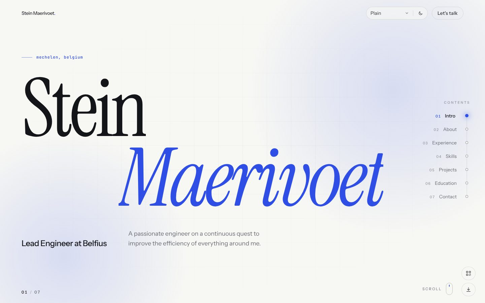
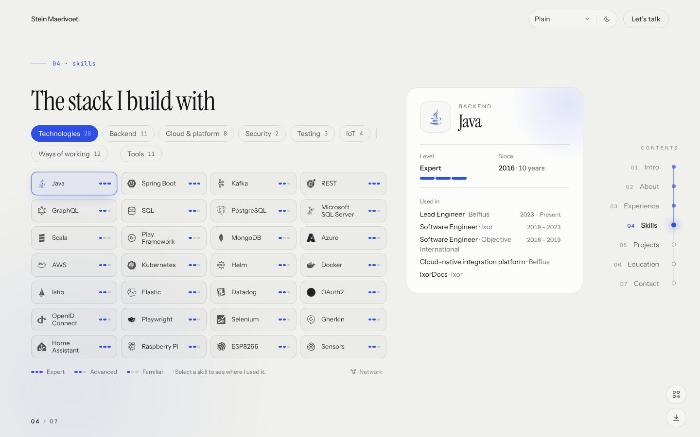
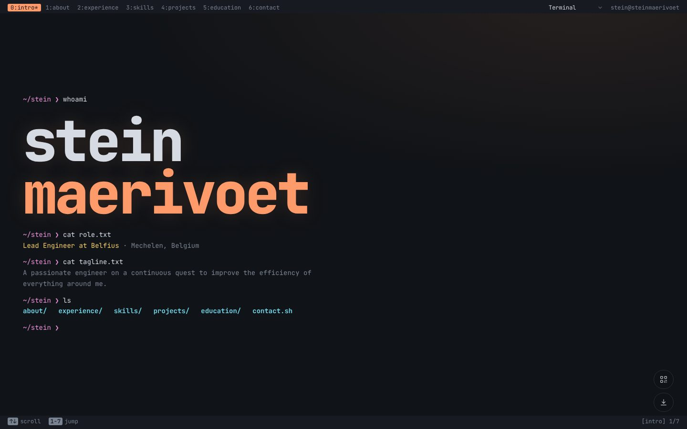
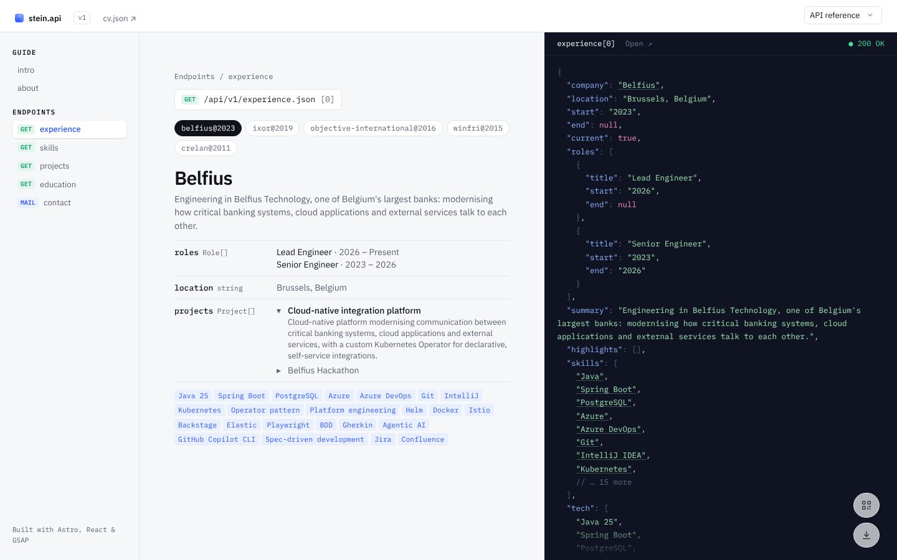
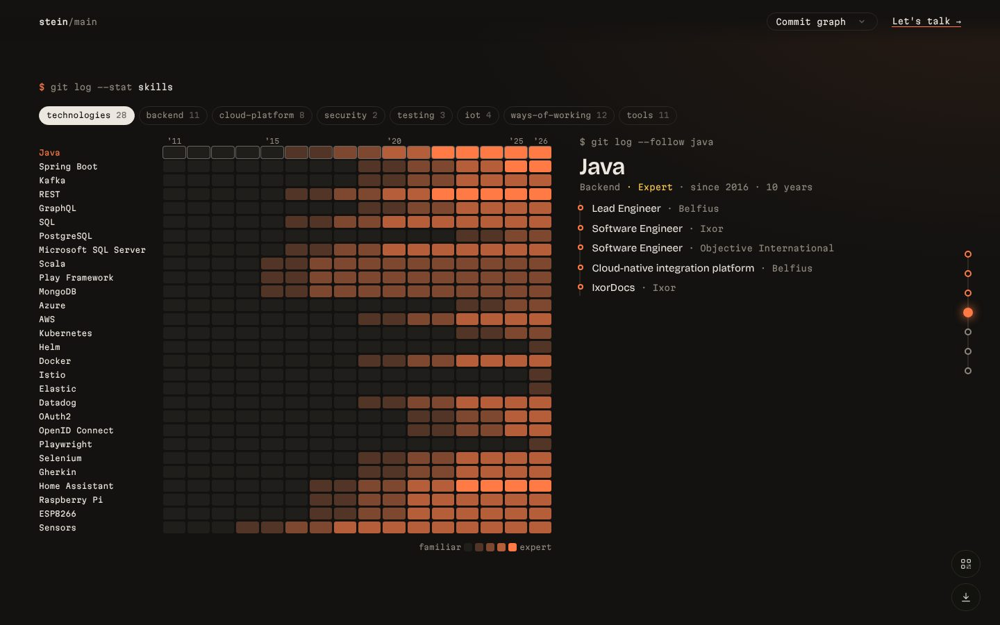
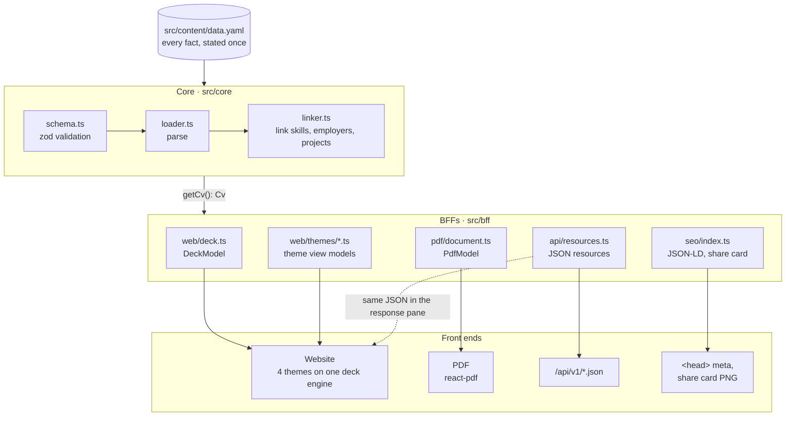

<div align="center">

# steinmaerivoet.dev

**The interactive CV of Stein Maerivoet, Lead Engineer at Belfius.**
One YAML file becomes a slideshow website in four themes, a print-ready PDF, a styled QR code and a public JSON API.

[**Visit the site**](https://steinmaerivoet.dev) · [Download the PDF](https://steinmaerivoet.dev/stein-maerivoet-curriculum-vitae.pdf) · [Browse the API](https://steinmaerivoet.dev/api/v1/cv.json)




</div>

## Contents

- [What it is](#what-it-is)
- [Four themes, one CV](#four-themes-one-cv)
- [Everything one build publishes](#everything-one-build-publishes)
- [Quick start](#quick-start)
- [Editing the CV](#editing-the-cv)
- [How it works](#how-it-works)
- [Project structure](#project-structure)
- [Testing](#testing)
- [Hosting and deployment](#hosting-and-deployment)
- [Documentation](#documentation)

## What it is

A CV that feels like a deck of slides rather than a long page. Every scroll, swipe or arrow key glides to exactly the next slide, and the deck never rests between two slides. Underneath, the CV is a linked web: every skill knows where it was used, and every employer and project knows its skills, so a visitor can click from Java to the Belfius integration platform to Kubernetes and back.

**Highlights**

- **Magnetic slide snapping.** Wheel and trackpad pull the page with growing resistance, then let go and glide. One gesture moves at most one slide, including the inertia a trackpad or Magic Mouse adds after the fingers lift.
- **Skills at the centre.** Each skill shows its level, since when and where it was used. A hidden "Network" view draws the whole graph of skills, employers and projects.
- **Cross-links everywhere.** Technology chips, "Used in" lists and the JSON shown in the API reference theme are all links to the right slide and item.
- **Content-only edits.** All copy lives in [`src/content/data.yaml`](src/content/data.yaml), validated by a zod schema at build time. A broken link or a missing field fails the build with the exact path.
- **Static and fast.** Everything is rendered at build time. A visitor downloads only the theme they look at, and icons ship once as an SVG sprite.
- **Found and shared well.** The whole career is in schema.org JSON-LD, link previews get a share card drawn from the CV, and `robots.txt` and `sitemap.xml` are generated.
- **Accessible.** Inactive slides are `inert`, tabs and panels have proper roles, deep links work (`/#skills`), and "reduce motion" is respected.

## Four themes, one CV

Pick a theme with the switcher at the top of the page. The current slide travels along, so `/#skills` stays on Skills.

| Theme | Path | Idea |
| --- | --- | --- |
| **Plain** (default) | [`/`](https://steinmaerivoet.dev/) | Editorial, light and dark, serif display type. |
| **Terminal** | [`/terminal/`](https://steinmaerivoet.dev/terminal/) | A tmux session: `whoami`, neofetch, fzf, htop, `ls`, `tree`. |
| **API reference** | [`/api-reference/`](https://steinmaerivoet.dev/api-reference/) | Developer docs. The response pane shows the real `/api/v1` JSON, with every name in it clickable. |
| **Commit graph** | [`/commit-graph/`](https://steinmaerivoet.dev/commit-graph/) | The career as git history: branch graph, stack diffs, a skills heatmap, PRs and tags. |

<table>
  <tr>
    <td width="50%"><br><sub><b>Plain</b> · skills with "Used in" links</sub></td>
    <td width="50%"><br><sub><b>Terminal</b> · intro</sub></td>
  </tr>
  <tr>
    <td width="50%"><br><sub><b>API reference</b> · experience endpoint and live JSON</sub></td>
    <td width="50%"><br><sub><b>Commit graph</b> · skills heatmap</sub></td>
  </tr>
</table>

## Everything one build publishes

`npm run build` turns `data.yaml` into a folder of static files in `dist/`:

| Output | Path | Built by |
| --- | --- | --- |
| Website, one page per theme | `/`, `/terminal/`, `/api-reference/`, `/commit-graph/` | [`src/pages/*.astro`](src/pages) |
| A4 PDF CV, two pages, with a QR code back to the site | [`/stein-maerivoet-curriculum-vitae.pdf`](https://steinmaerivoet.dev/stein-maerivoet-curriculum-vitae.pdf) | [`src/pdf/CvDocument.tsx`](src/pdf/CvDocument.tsx) (react-pdf) |
| Styled QR code (dots, rounded eyes, the `#S` mark) | [`/stein-maerivoet-qr-code.png`](https://steinmaerivoet.dev/stein-maerivoet-qr-code.png) (2048 px) and [`.svg`](https://steinmaerivoet.dev/stein-maerivoet-qr-code.svg) | [`src/qr/styledQr.ts`](src/qr/styledQr.ts) |
| JSON API, versioned, CORS open | [`/api/v1/cv.json`](https://steinmaerivoet.dev/api/v1/cv.json), `profile`, `experience`, `projects`, `skills`, `education` | [`src/bff/api/resources.ts`](src/bff/api/resources.ts) |
| Share card (Open Graph image) | `/stein-maerivoet-share-card.png` | [`src/og/shareCard.ts`](src/og/shareCard.ts) (resvg) |
| `robots.txt`, `sitemap.xml` | `/robots.txt`, `/sitemap.xml` | [`src/pages`](src/pages) |

File names follow from `person.firstName` and `person.lastName`. The two round buttons in the bottom-right corner of every theme download the PDF and the QR code. The favicon set (`favicon.svg`, `favicon.ico`, touch and maskable icons) lives in [`public/`](public) and shares the `#S` mark with the QR code.

## Quick start

Requires **Node 22** or newer (see [`.nvmrc`](.nvmrc)).

```sh
npm install
npm run dev          # http://localhost:4321, with hot reload
```

| Command | What it does |
| --- | --- |
| `npm run dev` | Development server on port 4321. |
| `npm run build` | `astro check` (type-check) and the production build into `dist/`. |
| `npm run schema` | Regenerate `src/content/data.schema.json` after changing the zod schema. |
| `npm run preview` | Serve the production build. |
| `npm run test:unit` | Vitest: content service and BFFs. Fast, no browser. |
| `npm run test:e2e` | Playwright: builds, serves and drives every theme on four devices. |
| `npm test` | Both. Run this before pushing. |

> If the Playwright web server "exited early", a stale preview server is still running. Stop it with `npx astro preview stop`.

## Editing the CV

**All content lives in [`src/content/data.yaml`](src/content/data.yaml).** No component holds copy. Without touching code you can:

- change any text, role, project, skill, language or contact detail;
- add or remove items, and the layout adapts;
- reorder or hide slides with the `slides` list (hidden sections also disappear from the PDF);
- change the labels of buttons and navigation (`ui`, and `label` per section).

Skills, experience and projects are linked by name. A project points to its employer with `employer:`, and the `tech` of an employer and the `tags` of a project link to skills when they match a skill's `name` (or its `match` synonyms). The "Used in" lists, the clickable chips, the projects per employer and the network graph are all derived from that, so you never write them twice.

```yaml
skills:
  groups:
    - name: Backend
      items:
        - { name: Java, level: expert, since: 2016, icon: devicon:java }

experience:
  items:
    - company: Belfius
      roles: [{ title: Lead Engineer, start: 2026 }]
      tech: [Java 25, Spring Boot, Kubernetes]   # "Java 25" links to the Java skill

projects:
  items:
    - name: Cloud-native integration platform
      employer: Belfius                          # must equal a company above
      tags: [Java, Kubernetes, Helm]
```

Your editor checks the file as you type: [`src/content/data.schema.json`](src/content/data.schema.json) is a JSON Schema generated from the zod schema, and the first line of `data.yaml` points VS Code (with the recommended YAML extension) and IntelliJ to it, for autocomplete, hover docs and red underlines on typos. The build validates the file again and stops with a clear message, for example `experience.items.0.roles: Required` or `projects.Foo.employer: "Acme" is not a company under experience`. The full guide is in [docs/CONTENT.md](docs/CONTENT.md).

## How it works

One content file, one content service, a backend-for-frontend (BFF) per consumer, and thin front ends. It all runs at build time, so the "backend" is code that runs during `astro build`, and the site that ships is static.



Dependencies only point down. A theme never imports runtime code from `src/core`, and nothing in `src/core` knows that a website, a PDF or an API exists. The full picture, with diagrams of the build pipeline, the linking model, the deck engine, the theme contract and the deployment, is in **[docs/ARCHITECTURE.md](docs/ARCHITECTURE.md)**.

## Project structure

```
src/
  content/data.yaml          all content
  content/data.schema.json   JSON Schema for editors, generated from core/schema.ts
  core/                    content service: schema (zod), loader, linker, domain model
  bff/
    web/deck.ts            DeckModel shared by every website theme
    web/themes/*.ts        extra view model per theme (terminal, reference, git)
    pdf/document.ts        what goes into the PDF
    api/resources.ts       the JSON API under /api/v1/
    seo/index.ts           JSON-LD and share card content
    shared/                formatting, file names and icons for every front end
  web/
    deck/                  slideshow engine: track, snap, input, reveals, cross-links
    headless/              theme-agnostic behaviour: employer, skill and project selection
    shared/                RefLink/TermLink, ThemeSwitcher, downloads, icon sprite
    themes/<id>/           one folder per theme: index.tsx, Chrome.tsx, slides/, ui/, theme.css
    themes/registry.ts     the one list of themes
  pdf/                     PDF layout (react-pdf)
  qr/                      styled QR code (SVG and PNG)
  og/                      share card renderer
  layouts/Layout.astro     <head>: meta, JSON-LD, favicons, fonts
  pages/                   one page per theme, plus PDF, PNG, SVG, API, robots and sitemap
public/                    favicons, web manifest, _headers
tests/
  unit/                    vitest: core, BFFs, PDF
  e2e/                     Playwright: navigation, touch, reveals, layout, links, themes, QR, downloads
docs/                      architecture, content guide, screenshots
```

## Testing

Two suites guard the experience:

- **Unit tests** ([`tests/unit`](tests/unit), Vitest) check the content service and every BFF: linking picks the most specific skill, every graph node has an edge, the deck model is plain JSON that can cross into the browser, the API only names things that exist, and the PDF's QR code actually scans to the site.
- **End-to-end tests** ([`tests/e2e`](tests/e2e), Playwright) build and serve the real site and drive it like a visitor on **desktop** (1440×900), **laptop** (1366×768), **phone** (Pixel 7) and **small phone** (360×640). They cover wheel, trackpad, touch and keyboard snapping, reveals, deep links, the skill filters, cross-links between slides and the downloads, for every theme.

The UX rules the tests enforce:

1. The deck only rests exactly on a slide, and one gesture moves at most one slide.
2. Content that has been revealed never disappears again.
3. On desktop and laptop every slide fits without scrolling, in every employer and project state, in every theme. Phones may scroll inside a slide.
4. Interactions inside a slide (filters, tabs, accordions) never move the rest of the slide.

## Hosting and deployment

| Piece | Service |
| --- | --- |
| Domain `steinmaerivoet.dev` | Registered at [Porkbun](https://porkbun.com) |
| DNS | [Cloudflare](https://cloudflare.com) (Porkbun's nameservers point to Cloudflare) |
| Hosting | A Cloudflare **Worker** with static assets, configured in [`wrangler.jsonc`](wrangler.jsonc) |
| Builds | Cloudflare Workers Builds, connected to this GitHub repo |
| Email | Cloudflare Email Routing forwards `hello@steinmaerivoet.dev` to a private mailbox |

Every push to `main` builds and goes live on [steinmaerivoet.dev](https://steinmaerivoet.dev). Other branches and pull requests get their own preview URL on `*.workers.dev`. A build that fails (for example on a typo in `data.yaml`) never replaces the live site. Response headers (long caching for hashed assets, CORS for the API, security headers) come from [`public/_headers`](public/_headers).

Every step taken to set this up, from buying the domain to email forwarding, is in **[CLOUDFLARE.md](CLOUDFLARE.md)**.

## Documentation

| Document | For |
| --- | --- |
| [docs/ARCHITECTURE.md](docs/ARCHITECTURE.md) | Layers, build pipeline, linking model, deck engine, themes, recipes. With diagrams. |
| [docs/CONTENT.md](docs/CONTENT.md) | Editing `data.yaml`: every section, linking rules, validation, adding slides. |
| [CLOUDFLARE.md](CLOUDFLARE.md) | Domain, DNS, Workers deployment and email: every setup step. |
| [CLAUDE.md](CLAUDE.md) | Rules for AI-assisted edits to this repo. |

---

<sub>Built with Astro, React and GSAP. Content © Stein Maerivoet.</sub>
