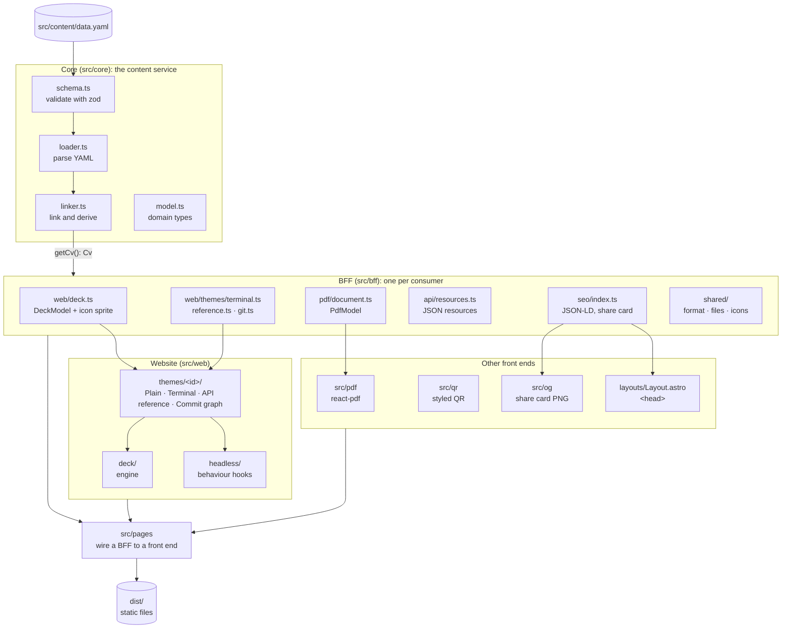
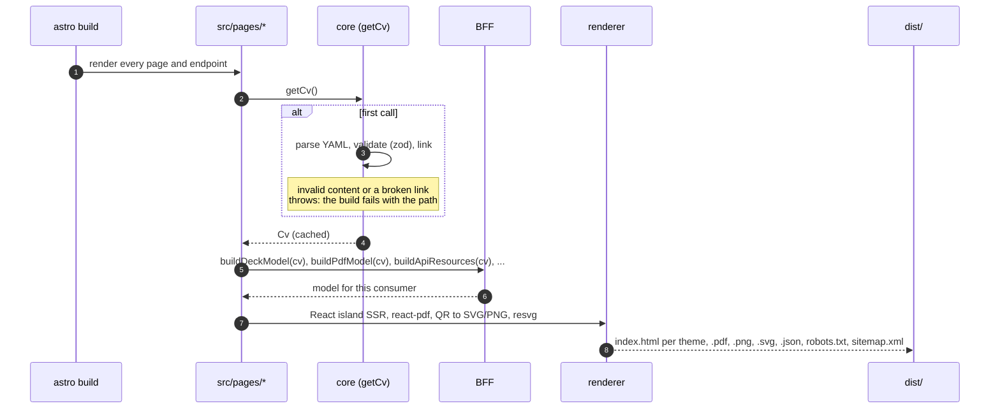
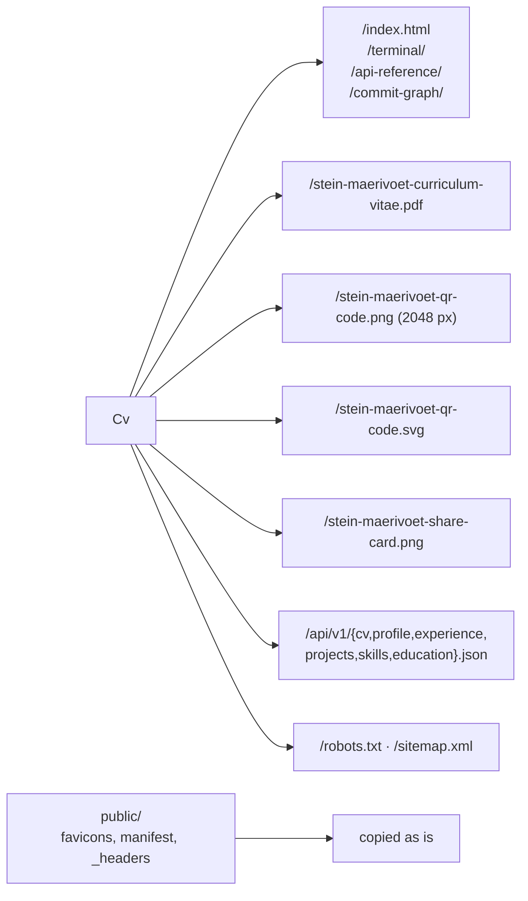
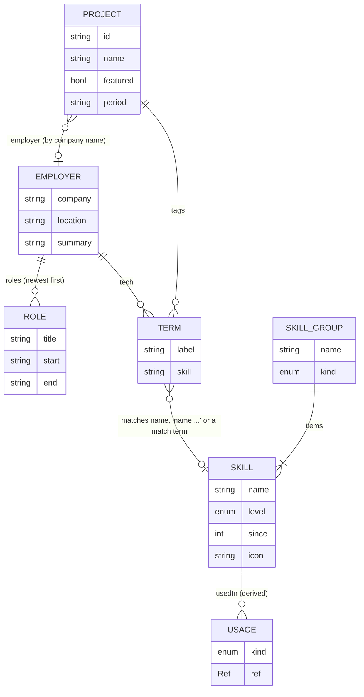
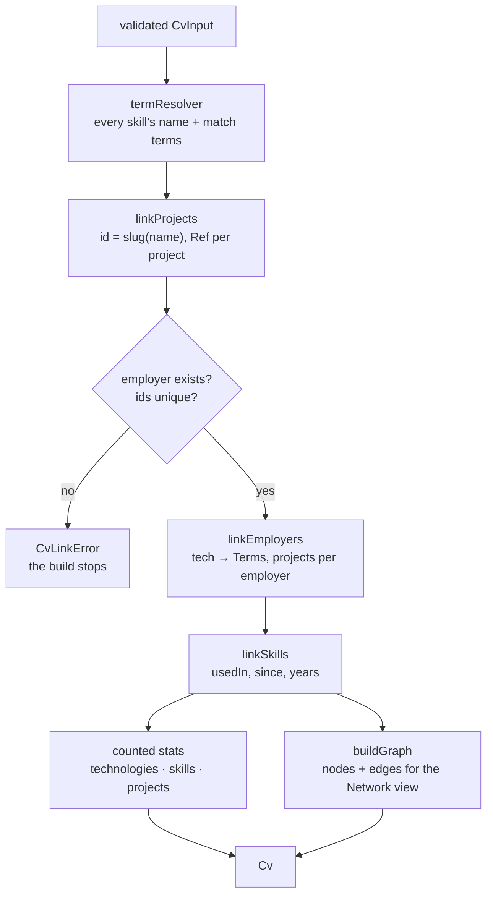
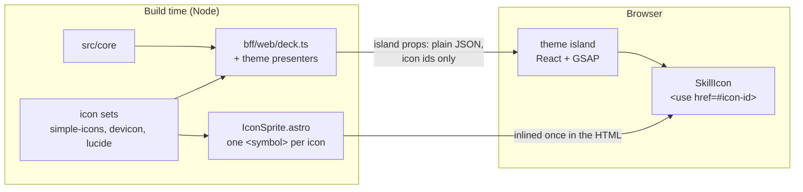
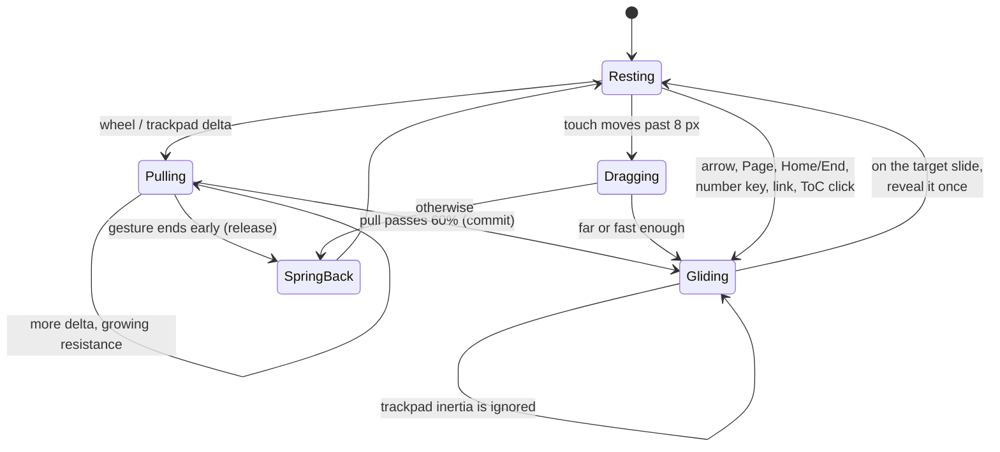
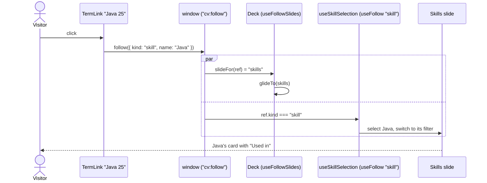
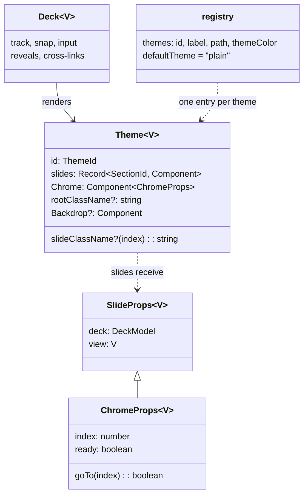
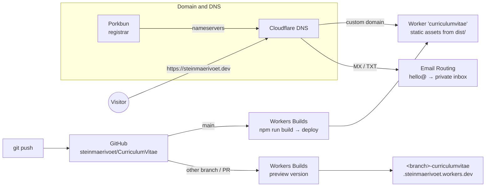

# Architecture

One source of content, one content service, a backend-for-frontend (BFF) per
consumer, and thin front ends. Everything runs at build time: the site is
static, so the "backend" is code that runs during `astro build`, and the BFFs
hand each front end exactly the data it renders.

- [The big picture](#the-big-picture)
- [Layers](#layers)
- [The build pipeline](#the-build-pipeline)
- [The content model and the linker](#the-content-model-and-the-linker)
- [Server-only and browser-safe](#server-only-and-browser-safe)
- [The deck engine](#the-deck-engine)
- [Cross-links between slides](#cross-links-between-slides)
- [Website themes](#website-themes)
- [Other front ends: PDF, QR code, API, SEO](#other-front-ends-pdf-qr-code-api-seo)
- [Hosting and delivery](#hosting-and-delivery)
- [Recipes](#recipes)
- [Tests](#tests)

## The big picture



## Layers

| Layer | Folder | Knows about | Responsibility |
| --- | --- | --- | --- |
| Content | `src/content/data.yaml` | nothing | Every fact, stated once. `data.schema.json` next to it is generated from `schema.ts` for editors. |
| Core | `src/core` | content | `schema.ts` validates (zod), `loader.ts` parses, `linker.ts` links and derives (usage, refs, graph, counted stats). `model.ts` holds the domain types. Fails the build on bad content. |
| BFF | `src/bff` | core | Shapes the domain model for one consumer. Formatting shared by all front ends is in `bff/shared` (`range`, file names, icons). |
| Engine | `src/web/deck` | BFF types | The slideshow: track, snap, input, reveals, cross-link routing. Knows nothing about how a slide looks. |
| Behaviour | `src/web/headless` | engine | Theme-agnostic state hooks: employer and skill selection, project spotlight, number keys, chrome intro. |
| Front ends | `src/web/themes/<id>`, `src/pdf`, `src/qr`, `src/og` | BFF, engine, headless | Layout and styling only. No content decisions, no copy. |
| Pages | `src/pages` | all | Wire a BFF to a front end: one static page per theme, the PDF, the QR code, the share card, the JSON API, `robots.txt` and the sitemap. |

Dependencies only point down this table. A theme never imports `src/core`
runtime code (types are fine), and nothing in `src/core` knows that there is
a website, a PDF or an API.

## The build pipeline

`npm run build` runs `astro check` (TypeScript in strictest mode, including
`.astro` files) and then `astro build`. Every page and endpoint asks the core
for the CV through `getCv()`, which parses and links `data.yaml` once and caches
the result for the rest of the build.



What ends up in `dist/`:



File names come from `bff/shared/files.ts` (`cvSlug`, `qrSlug`, `shareSlug`),
so the page that generates a file and the button that links to it can never
disagree.

## The content model and the linker

The CV is about skills. `data.yaml` states each fact once, and `linker.ts`
derives every other direction of every link.



What the linker does, in order:



- **Matching.** A label in `tech` or `tags` links to a skill when it equals
  the skill's name, starts with it plus a space ("Java 25" → Java), or matches
  one of its `match` terms. When several skills match, the longest term wins,
  so "Spring Boot" never links to a skill called "Spring".
- **Refs.** Every linkable item gets a `Ref` (`skill`, `employer`,
  `project`). A featured project links to its own card on the projects slide;
  any other project links to its employer, with the project opened.
- **Derived years.** A skill without `since` takes the first start year of the
  employers that used it. `years` counts from there to the build date.
- **Graph.** Skill, employer and project nodes, with an edge for every link. A
  node without edges points to a missing link, and the unit tests fail on it.

## Server-only and browser-safe



`bff/web/model.ts` (types and pure helpers) is browser-safe. `bff/web/deck.ts`
and the theme presenters run at build time only: they resolve icons from the
icon sets, which therefore never ship to the browser. The deck model crosses
into the browser as island props, so it must stay plain JSON and small (unit
tests guard both).

Island props are serialised into the page, so anything bulky that never
changes on the client stays out of them. Skill icons are the example: the
deck refers to an icon by id, the page renders every icon once as an SVG
sprite (`web/shared/IconSprite.astro`) and `SkillIcon` draws it with `<use>`.

## The deck engine

`src/web/deck/Deck.tsx` puts all slides on one vertical track and moves the
track with GSAP. The track only ever comes to rest exactly on a slide.
`useDeckInput.ts` turns wheel, trackpad, touch and keyboard input into a small
set of commands (`step`, `pull`, `commit`, `release`, `dragStart`,
`dragMove`, `dragEnd`), so the input handling never touches the DOM layout.



The rules that make it feel right:

- **Magnet.** Wheel and trackpad deltas pull the page towards the next slide
  with growing resistance. Pull far enough and it lets go and glides; stop
  earlier and it springs back.
- **One gesture, one slide.** A trackpad gesture ends after 160 ms of
  silence, a notched mouse wheel after 380 ms. The inertia a trackpad adds
  after the fingers lift belongs to the same gesture, and is ignored once it
  has committed.
- **Scroll inside first.** On small screens a slide may be taller than the
  viewport. Its `.slide-scroll` container scrolls first; only at its edge does
  the deck move. Horizontal swipes are left to carousels.
- **Reveal once.** `reveal.ts` animates `data-reveal`, `data-reveal-words`,
  split text and `data-count` counters the first time a slide becomes active,
  then marks it `is-seen`. Revealed content never disappears again.
- **Accessible.** Inactive slides are `inert`. `prefers-reduced-motion` makes
  every move instant and skips the counters. The hash (`#skills`) deep-links
  to a slide and survives a theme switch.

## Cross-links between slides

Every link to a skill, employer or project goes through `RefLink` or
`TermLink` (`src/web/shared/TermLink.tsx`). They call `follow(ref)`, which
dispatches one window event. The deck moves to the slide that owns the ref,
and the headless hook on that slide selects the item. The theme never calls
`follow()` itself.



The same path serves `useEmployerSelection` (opens the employer and the
linked project) and `useProjectSpotlight` (highlights a featured project). In
the API reference theme, `useJsonLinker` makes the names inside the JSON
response pane links too.

## Website themes

A theme is a `Theme<V>` (`src/web/themes/types.ts`): one component per slide,
a `Chrome` (the fixed UI around the slides) and optional classes. `V` is the
theme's own view model, built by its presenter in `src/bff/web/themes/<id>.ts`
when it needs more than the shared `DeckModel`.



| Theme | Page | Presenter | Idea |
| --- | --- | --- | --- |
| Plain (default) | `/` | none | Editorial, light and dark. |
| Terminal | `/terminal/` | `terminal.ts` | A tmux session: neofetch, fzf, htop, ls, tree, a prompt. |
| API reference | `/api-reference/` | `reference.ts` | Developer docs; the response pane shows the real `/api/v1` JSON. |
| Commit graph | `/commit-graph/` | `git.ts` | The career as git history: branch graph, stack diffs, heatmap, PRs, tags. |

The registry (`src/web/themes/registry.ts`) is the one list of themes: the
switcher, the pages and the tests read it. Each theme is its own static page,
so a visitor only downloads one theme; the switcher navigates and keeps the
slide in the hash.

Design tokens: each theme sets `--c-*` (colours) and `--f-*` (fonts) under
`[data-theme="<id>"]` in its `theme.css`. Components use the semantic
utilities (`bg-bg`, `text-fg`, `text-mute`, `border-line`, `text-accent`,
`font-display`, ...), so shared components such as the downloads and the theme
switcher look right in every theme.

### Conventions every theme follows

These keep behaviour and accessibility the same across themes, and let one
test suite (`tests/e2e/themes.spec.ts`) check all of them.

- Cross-links go through `RefLink` / `TermLink` (`src/web/shared/TermLink.tsx`).
  Never call `follow()` by hand in a theme.
- Selection state comes from the headless hooks (`useEmployerSelection`,
  `useSkillSelection`, `useProjectSelection` / `useProjectSpotlight`), so a link
  from anywhere lands on the right item in every theme.
- Employers and skill filters are `role="tab"` inside a `role="tablist"`.
  The employer detail has `id="experience-panel"` with the company in an `h3`;
  a project inside it is a button with `aria-expanded`. A selected skill has
  its name in an `h3`.
- Elements with `data-reveal` animate in once; `data-chrome` elements fade in
  through `useChromeIntro`.
- On desktop and laptop every slide fits without scrolling, in every state. A
  slide whose content changes with a selection anchors to the top, so nothing
  above the selection moves.
- Theme vocabulary (shell commands, HTTP methods, git verbs) lives in the
  theme's presenter. CV content and UI copy live in `data.yaml`.

## Other front ends: PDF, QR code, API, SEO

**PDF.** `bff/pdf/document.ts` decides what goes in (sections hidden from
`slides` stay out, roles at one employer are grouped, only skill levels in use
are explained). `src/pdf/CvDocument.tsx` lays out two A4 pages with
react-pdf in the Plain theme's colours, with real selectable text for
applicant tracking systems. The header carries the site's QR code (light
colours, best for print) and a clickable link to the site, so someone who
only has the PDF finds the interactive version.

**QR code.** `src/qr/styledQr.ts` builds the code with error correction H
(about 30% of the code may be lost) and draws it as SVG: round dots, rounded
finder "eyes" and the `#S` mark from the favicon in the middle, as outlined
paths so it needs no font. The mark covers well under 10% of the modules. The
same SVG is published as a vector and, through resvg, as a 2048 px PNG. An
e2e test decodes the downloaded PNG and a unit test decodes the QR in the PDF,
both with zxing, to prove they scan to the site.

**JSON API.** `bff/api/resources.ts` publishes the CV as static, versioned
JSON under `/api/v1/`. Field names are the contract: change them only with a
new version. The API reference theme renders these exact resources, so what
the site shows as a response is what the endpoint returns. `_headers` opens
CORS for `/api/*`.

**SEO and link previews.** The slides only render the selected employer, so
`bff/seo` gives crawlers the whole CV another way: `Layout.astro` puts the
schema.org `ProfilePage` / `Person` (every role, its story, projects and
skills) in a JSON-LD script, and the Open Graph tags point at a share card
that `og/shareCard.ts` draws from data.yaml and renders to PNG at build time
(resvg, with the site's own fonts): the name, headline, tagline and About
figures on the left, and the site's QR code on an ink panel on the right.
`robots.txt` and `sitemap.xml` are generated from `meta.url`.

**Download buttons.** `web/shared/Downloads.astro` puts three buttons in the
bottom-right corner of every theme, top to bottom: the PDF CV, the QR code and
the share card. `bff/web/downloads.ts` gives each its label (data.yaml `ui`),
format line and file name. Each button is a logo followed by its label and
format. The column is open on the intro and contact slides (the deck sets
`data-slide` on `<html>`), on hover and when tabbing into it, and folds into a
column of logos on the other slides so it never covers content. A theme can
tune it with `--dl-radius`, `--dl-label-font` and `--dl-on-hero: 0` (keep it
folded on the intro, as the Commit graph theme does for its branch graph).

## Hosting and delivery

The site is a folder of static files, served by a Cloudflare Worker with
static assets (`wrangler.jsonc` points it at `./dist`). The step-by-step
setup is in [CLOUDFLARE.md](../CLOUDFLARE.md).



Caching and security headers come from `public/_headers`: hashed assets
under `/_astro/` are cached for a year, the API for an hour with open CORS,
and every response gets `nosniff`, a strict referrer policy, a permissions
policy and `X-Frame-Options`.

## Recipes

**New field in the CV.** Add it to `src/core/schema.ts` (with a default) and
to `data.yaml`. If it needs deriving, do it in `linker.ts`. Then expose it in
the BFF of each front end that should show it.

**New slide.** Add the id to `sectionIds` in `src/core/model.ts` and its
content to the schema. Give every theme a component in
`src/web/themes/<id>/slides/` and register it in that theme's `slides`
(TypeScript reports a theme that forgets one). Add the id to `slides` in
`data.yaml`.

**New theme.** Add it to the registry, add `src/web/themes/<id>/` (an
`index.tsx` island, `Chrome.tsx`, `theme.css`, one component per slide), a
presenter in `src/bff/web/themes/<id>.ts` if it needs one, and a page in
`src/pages`. Add it to `THEMES` in `tests/e2e/themes.spec.ts`.

**New front end** (another document format, a feed, ...). Add a BFF folder in
`src/bff/<name>` that turns `Cv` into what the front end needs, then a page
or endpoint in `src/pages` that renders it. The PDF (`bff/pdf` +
`src/pdf/CvDocument.tsx`) and the JSON API (`bff/api` +
`pages/api/v1/[resource].json.ts`) are the two examples.

**Animations without code.** `data-reveal` (staggered fade-in),
`<SplitText>` (letters, Plain), `data-reveal-words` (word by word) and
`data-count="42"` (a counter) work on any element in a slide.

## Tests

```sh
npm run test:unit   # vitest: core and BFFs (fast, no browser)
npm run test:e2e    # Playwright: every theme on desktop, laptop and two phones
npm test            # both
```

| Suite | Files | Covers |
| --- | --- | --- |
| Unit | `tests/unit/core.test.ts` | Loading, most-specific matching, usage both ways, projects per employer, counted stats, derived years, every graph node has an edge, error paths. |
| Unit | `tests/unit/bff.test.ts` | Shared formatting, deck model is plain JSON with sprite icons, PDF model, API names only existing items, theme presenters, SEO data and share card. |
| Unit | `tests/unit/pdf.test.ts` | The PDF renders, links to the site, and its QR code scans. |
| E2E | `navigation`, `touch`, `reveal` | Snapping on wheel, trackpad, keyboard and touch; reveals stay. |
| E2E | `layout` | Every slide fits on desktop and laptop, in every state. |
| E2E | `experience`, `skills`, `links` | Selections, filters and cross-links between slides. |
| E2E | `themes` | The shared conventions, for every theme in the registry. |
| E2E | `download`, `qr` | The PDF, QR and share card downloads, their order in the corner, and that both QR codes scan. |

The Playwright config builds the site, serves the production build and runs
on four devices: desktop (1440×900), laptop (1366×768), Pixel 7 and a small
phone (360×640). Screenshots of every slide land in `test-results/screens`.
