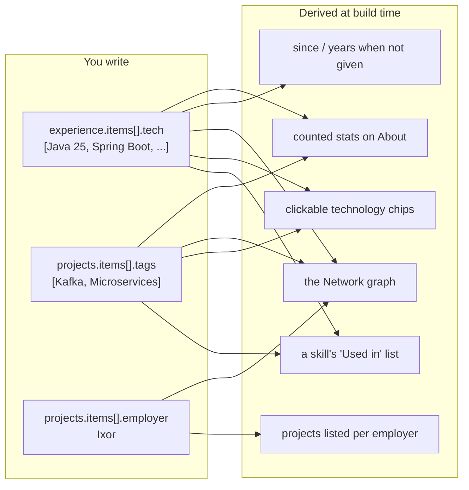

# Editing the CV

Everything a visitor reads, on the site, in the PDF and in the API, comes from
one file: [`src/content/cv.yaml`](../src/content/cv.yaml). Components never
hold copy. Change the YAML, run `npm run dev`, and every theme, the PDF and
the API follow.

- [The sections](#the-sections)
- [Linking skills, employers and projects](#linking-skills-employers-and-projects)
- [Validation](#validation)
- [Common edits](#common-edits)
- [Adding a new field or slide](#adding-a-new-field-or-slide)

## The sections

| Key | What it holds | Notes |
| --- | --- | --- |
| `meta` | Page title, description, canonical `url`, `lang` | `url` drives the QR code, the sitemap, `robots.txt` and the share card. |
| `slides` | Order and visibility of the slides | `hero`, `about`, `experience`, `skills`, `projects`, `education`, `contact`. Leave one out to hide it on the site and in the PDF. |
| `ui` | Small labels: navigation, buttons, footer, PDF QR caption | Every key has a default. |
| `person` | Name, headline, tagline, location, public email, socials, availability badge | `firstName` and `lastName` also name the files (`stein-maerivoet-curriculum-vitae.pdf`). |
| `about` | Statement, paragraphs, stats | A stat's `value` is a number, or `technologies`, `skills` or `projects` to count it from the CV. |
| `experience` | One item per employer, like LinkedIn | `roles` newest first (`end: null` means current), `summary`, `highlights`, `tech`. |
| `skills` | Skill groups, each with a `kind` | `technology`, `practice` or `tool`. Per skill: `name`, `level`, `since`, `icon`, `match`. |
| `projects` | Every project, once | `employer`, `period`, `featured`, `summary`, `description`, `url`, `tags`. |
| `education` | Degrees, certifications, languages | |
| `contact` | Heading, text, button label | The address is `person.email`. |

Section labels (`label`) and the labels inside a section (`usedInLabel`,
`levelLabels`, `presentLabel`, ...) live with their section.

### Skill icons

`icon` accepts:

- a [Simple Icons](https://simpleicons.org) slug, for example `kubernetes`;
- `devicon:<name>` for logos Simple Icons lacks, for example `devicon:java`;
- `lucide:<name>` for concepts without a logo, for example `lucide:database`.

Icons are resolved at build time and shipped once as an SVG sprite, so adding
icons does not grow the JavaScript.

## Linking skills, employers and projects

The CV is about skills, so every skill should be traceable to where it was
used, and every employer and project to its skills. You state each link once;
the rest is derived.



**How a label matches a skill.** An entry in `tech` or `tags` links to a
skill when it:

1. equals the skill's `name`, ignoring case,
2. starts with the name plus a space (`Java 25` links to `Java`, `JavaScript` does not), or
3. does either of those with one of the skill's `match` terms (`Postgres` links to `PostgreSQL`).

When several skills match, the longest term wins. A label that matches no
skill still shows, as plain text.

**Projects and employers.** `employer:` must equal a `company` under
`experience`, letter for letter. A featured project gets a card on the
projects slide, and links to it go there. Any other project with an employer
appears inside that employer on the experience slide, and links open it
there.

**Check your links.** Open the skills slide and press "Network". A node with
no edges points to a missing link. The unit tests fail on it too.

## Validation

The schema in [`src/core/schema.ts`](../src/core/schema.ts) checks the file on
every build and every dev reload. Problems are reported with their path, all
at once:

```text
src/content/cv.yaml is invalid:
  • experience.items.0.roles: Required
  • person.email: Invalid email address
```

```text
src/content/cv.yaml has broken links:
  • projects.Winfri platform.employer: "Winfry" is not a company under experience
```

A build that fails never replaces the live site, so a typo is safe: the
previous version stays online until it is fixed.

## Common edits

**A new skill.** Add it to the right group, then check that the `tech` of
employers and the `tags` of projects actually match it. Add `match:` terms
for synonyms.

```yaml
- { name: PostgreSQL, level: advanced, icon: postgresql, match: [Postgres] }
```

**A new project.** Set `employer` when there is one, and add `tags` that name
its skills. Set `featured: true` to give it its own card.

```yaml
- name: Verkeerscentrum
  employer: Ixor
  period: 2022 – 2023
  featured: true
  description: >-
    Application for operators to control the traffic in Flanders.
  tags: [Event-driven, Kafka, Microservices, Spring Boot]
```

**A new role at the same employer.** Add it at the top of that employer's
`roles`. The employer's overall title, start and end are derived from its
roles.

**A new employer.** Add an item to `experience.items` and list its skills in
`tech`.

**Hide a slide.** Remove its id from `slides`. It disappears from every theme
and from the PDF.

**Show "available".** Set `person.available: true` and, optionally,
`person.availabilityText`.

## Adding a new field or slide

New copy always goes into the schema and the YAML, never into a component:

1. Add the field to `src/core/schema.ts` with a sensible default.
2. Add it to `cv.yaml`.
3. If it needs deriving, do it in `src/core/linker.ts`.
4. Expose it in the BFF of every front end that should show it.

For a new slide, see the recipes in [ARCHITECTURE.md](ARCHITECTURE.md#recipes).
